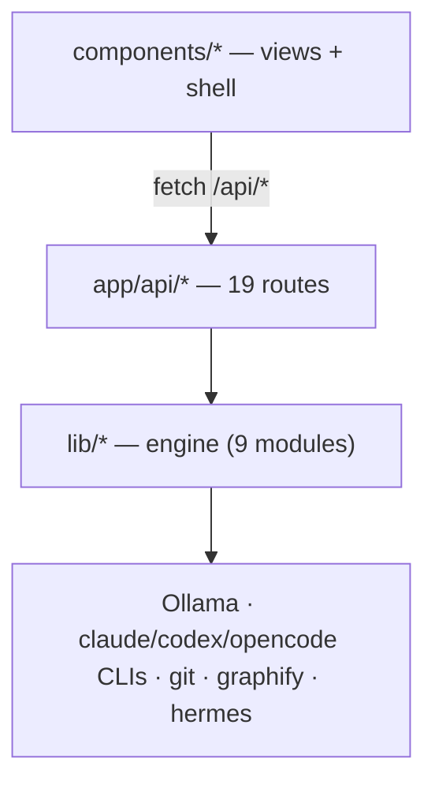

# Architect report — agent-os

A two-pager synthesised from four evidence artifacts (links inline). Each claim
traces to git history or the import graph; unknowns are stated, not filled.

## 1. What this repo is
agent-os is a **local "Mission Control" dashboard** (Next.js 15, App Router, TS)
that orchestrates several AI agents — Claude, Codex, OpenClaw, local Ollama — from
one UI. Its defining quality is a **clean, one-directional architecture**:

The UI never imports `lib` directly (grep `@/lib` in `components` = empty); it talks
to the backend only over HTTP. That boundary is the codebase's biggest asset.
→ detail: [`context/map/repo-map.md`](context/map/repo-map.md)

## 2. Where the work and the friction live
- **Hot areas** (git history): `components` (63 changes) ≫ `app/api` (39) ≫ `lib` (31).
- **Two choke points** (import graph, fan-in 5): `lib/cliAgent.ts` (every CLI agent
  runs through it) and `lib/runs.ts` (telemetry on every run).
- **Tightest coupling** (git co-change 6/7): `Sidebar.tsx` ⇄ `MissionControlLayout.tsx`
  — adding any view edits both.
- **No dependency cycles.** Single author (8-day window) → territorial/contributor
  signal is weak; structure carries the map.

## 3. Core feature + its technical debt
**Multi-agent fan-out** (powers Broad Opinion / Delegate / Code Review): one task →
`Promise.all` over an agent list → `runCliAgent` → per-CLI runner → spawn → back, each
call timed read-only in the attached repo. Debt found:
- **D1 — the agent roster is duplicated 4×** (3 route arrays + the UI registry).
  Removing the dead Gemini tier had to touch all three — proof of the tax.
- **D2/D3 — the fan-out routes and `lib/runs.ts` have no tests** (only the individual
  runners are covered).
→ detail: [`context/changes/multi-agent-fanout/research.md`](context/changes/multi-agent-fanout/research.md)

## 4. Recommended refactor (defended, ranked)
1. **Extract one shared agent roster** (`lib/roster.ts`). Highest debt-of-drift for the
   lowest change cost; reversible; blast radius = the three routes. First step: a thin
   council-route test to lock behaviour, then migrate the three arrays.
2. **Data-driven view registry** — replace the Sidebar array + Layout branches with one
   `VIEWS` registry so adding a view is one entry, not two lockstep edits. Hottest
   coupling, slightly riskier (modal + landing are special cases).
→ detail: [`context/changes/refactor-opportunities/research.md`](context/changes/refactor-opportunities/research.md)

## 5. Domain finding (the one that matters most)
Modelling the domain (DDD distillation) surfaced a **model-vs-code drift on the Brain**
(the Night-Shift second brain). Its defining invariant — *sources are immutable; "no
source, no note"* — is **declared in the `house-rules.md` charter but enforced only by a
prompt**, while the refiner runs Claude in **write mode** (`acceptEdits`, `cwd=brain`).
Nothing in code stops a misbehaving run from mutating a source. A second brain you can't
trust is worse than none, so this is the **#1 aggregate to harden**: a code-level guard
that refuses writes outside `2-atoms/3-threads/briefings/` and verifies every new atom
cites a source. (Two other invariants — every Run has a status; fan-out is read-only —
are already enforced in code.)
→ detail: [`context/domain/01-domain-distillation.md`](context/domain/01-domain-distillation.md)

## 6. If I had one week
Ship **D1 (shared roster)** first — small, safe, removes a proven tax and unblocks a
single place to add/disable agents. Then make the **Brain invariant real in code** (the
domain finding) — it converts the product's core *trust* promise from prose into an
enforced guard. Both are reversible, both have contained blast radius, and both are
backed by the evidence above rather than taste.

## Limitations
8-day single-author history (weak territorial/contributor signal);
dependency-cruiser not yet TS-configured (no auto graph image — couplings come from the
import graph + git co-change, stated per claim); the map describes activity and
structure, not runtime correctness.
