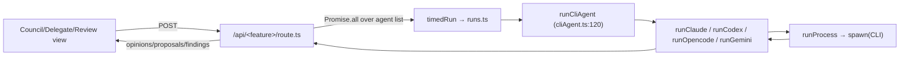

# Research — multi-agent fan-out

**Feature:** one task / question → run it across several agents in parallel and
return each result. Powers **Broad Opinion (council)**, **Delegate Task**, and
**Code Review**. Grounded in `context/map/repo-map.md` (the `cliAgent` choke point).

## 1. Feature overview

### End-to-end trace
```
UI view ──fetch──▶ /api/<feature>/route.ts ──▶ runCliAgent ──▶ run<Agent> ──▶ runProcess ──▶ spawn(CLI) ──▶ extract ──▶ JSON back
```
| Step | File:line |
|---|---|
| UI fan-out (Council/Delegate/Review) | `CouncilView.tsx` / `DelegateView.tsx` / `ReviewView.tsx` |
| Route fans out over an agent list, `Promise.all` | `api/council/route.ts:27`, `api/delegate/route.ts:54`, `api/review/route.ts:57` |
| Each call wrapped in telemetry | `timedRun(...)` → `lib/runs.ts` |
| Dispatch by backend | `runCliAgent` `lib/cliAgent.ts:120` |
| Per-CLI runners | `runClaude:69` · `runCodex:77` · `runOpencode:102` · `runGemini:111` |
| Spawn + timeout + stdin=ignore | `runProcess` `lib/cliAgent.ts:10` |
| Read-only / write / timeout flags | `RunOpts` `lib/cliAgent.ts:6` |



### Behaviour that matters
- Fan-out is **parallel** (`Promise.all`); a failing agent resolves to `{ ok:false }`
  rather than failing the whole batch.
- Council/delegate/review run agents **read-only**, `cwd = attached repo`, `timeoutMs 300_000`.
- Each batch shares a `batchId` so Observability can show head-to-head.

## 2. Technical debt

| # | Debt | Evidence | Why it bites |
|---|---|---|---|
| D1 | **Agent roster duplicated 3×** | separate `COUNCIL` / `AGENTS` / `REVIEWERS` arrays in council/delegate/review routes | removing Gemini (dead tier) required editing **all three**; adding an agent will too — easy to miss one |
| D2 | **Fan-out routes untested** | no `route.test.ts` for council/delegate/review/observability | the orchestration (parallel, error→`{ok:false}`, batchId, telemetry) is unverified; only the individual runners (`cliAgent.test.ts`) are covered |
| D3 | **`lib/runs.ts` untested** | no `runs.test.ts` | telemetry sits in the hot path of every run; `agentStats`/`timedRun` logic is unchecked |
| D4 | **`timeoutMs: 300_000` magic literal ×3** | repeated in council/delegate/review | a policy change means three edits |

### Test-coverage map (the path)
| On the path | Covered? |
|---|---|
| `runClaude/runCodex/runOpencode/runGemini`, `extractCodexAnswer`, `extractOpencodeAnswer`, `runCliAgent` dispatch | ✅ `cliAgent.test.ts` |
| `chat` route (CLI branch) | ✅ `chat/route.test.ts` |
| **council / delegate / review fan-out** | ❌ none |
| **`runs.ts` (timedRun, agentStats)** | ❌ none |

### Blast radius
- Change `runCliAgent`'s signature → 4 callers (council, chat, delegate, review) + `runClaude` used directly by `brain/refine`.
- Add/remove an agent → 3 route arrays **+** `agents.ts` registry **+** `BACKEND_OPTIONS` (D1).
- Touch `runs.ts` schema → `observability/route.ts` + `ObservabilityView` read it.
- Static graph (artifact 2 fan-in 5) **agrees with** git co-change (artifact 1): these files move together.

## 3. Verification
Claims above are grep/import-graph verified (callers, missing test files, duplicated
arrays). The single highest-value, lowest-risk fix is **D1 — extract one shared agent
roster** (kills the 3× duplication that already caused real edits). That becomes the
refactor target (M4L4).
