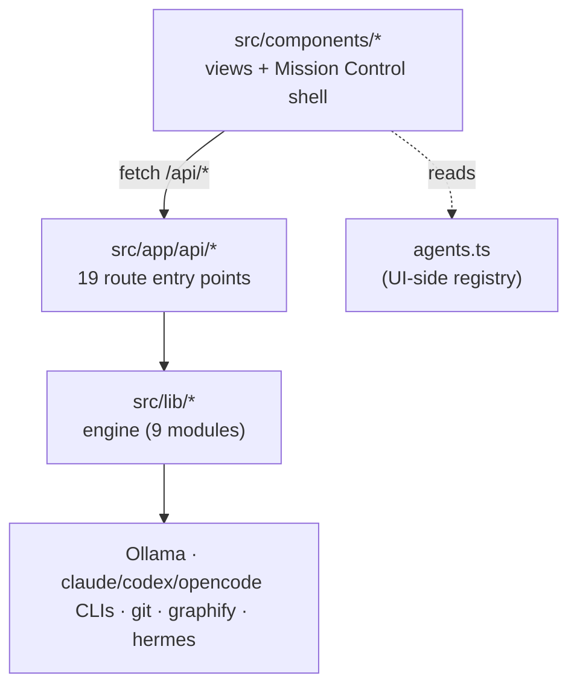

# Repo map — agent-os

> Onboarding map synthesised from three evidence artifacts in this folder
> (`artifact-1-territory`, `-2-structure`, `-3-contributors`). It does not
> repeat their tables; it folds them into one picture: *where the system lives
> → how it's wired → who to ask*.

## 1. TL;DR
agent-os is a **local "Mission Control" dashboard** (Next.js 15, App Router, TS)
that orchestrates several AI coding agents from one UI. It has a clean,
one-directional architecture: **UI (React components) talks to the backend only
over HTTP `/api/*`, and those routes call a small `lib/` engine** that shells out
to local models (Ollama) and subscription CLIs (claude/codex/opencode). Work
concentrates in three places — `src/components` (the views), `src/app/api` (19
route entry points), and `src/lib` (the engine). The friction lives in two spots:
the **Sidebar ⇄ MissionControlLayout wiring pair** (every new view edits both) and
the **`lib/cliAgent.ts` choke point** (every multi-agent feature runs through it).
There are **no dependency cycles** and the UI↔engine boundary is the codebase's
biggest asset.

## 2. Territory — where the system lives
- **Deep / high-responsibility:** `src/components` (63 changes — all the views and
  the shell), `src/lib` (31 — the engine).
- **Entry surface:** `src/app/api` (39 — 19 route handlers).
- **Activity in time:** 40 commits over 8 days (2026-06-14 → 06-22), built
  feature-by-feature. Each feature = a `*View.tsx` + an `/api/<feature>/route.ts`
  + two edits to the Sidebar/Layout wiring pair.
- Directory tree ≈ real activity here (young repo), so structure is honest — the
  one mismatch is that `agents.ts` *looks* like a leaf but is a whole-repo hub.

## 3. Real couplings (and where each is known from)
| Coupling | Strength | Known from |
|---|---|---|
| `Sidebar.tsx` ⇄ `MissionControlLayout.tsx` | 6 of 7 commits together | **git history** (artifact 1) |
| `lib/cliAgent.ts` → council/chat/delegate/review/brain | fan-in 5 | **import graph** (artifact 2) |
| `lib/runs.ts` → council/chat/delegate/review/observability | fan-in 5 | **import graph** |
| `lib/repo.ts` → council/delegate/review/upload | fan-in 4 | **import graph** |
| UI ↔ `lib` | **none direct** (HTTP only) | import graph (grep `@/lib` in components = empty) |

No cycles. No generated/mocked "false couplings" of note (tests mock their deps).

## 4. Risk zones
| Zone | Why it's risky |
|---|---|
| `lib/cliAgent.ts` | one change touches every multi-agent feature (5 callers); also owns timeouts + read-only/write modes |
| Sidebar ⇄ Layout wiring pair | adding/renaming a view needs both edited in lockstep; easy to half-wire |
| `lib/runs.ts` | telemetry is in the hot path of every run; a throw here could break a real run (guarded today) |
| `lib/brain.ts` + `/api/brain/refine` | the only place an agent runs in **write** mode on disk — highest blast radius |
| External-process coupling | Ollama/CLI availability + the dead Gemini tier live outside the type system — failures are runtime, not compile-time |

## 5. Who to ask
Single-author repo → **Monika Sadlok** owns every zone (100% of commits). The real
risk is not "who else knows" but "is it written down" — which this map addresses.

## 6. First day — read these in order
1. `src/app/page.tsx` → `src/components/MissionControlLayout.tsx` — the view router (how the app is shaped).
2. `src/components/Sidebar.tsx` — the nav ⇄ view contract (the wiring pair).
3. `src/components/agents.ts` — the agent + backend registry everything reads.
4. `src/lib/cliAgent.ts` — the engine choke point (how every CLI agent runs).
5. `src/app/api/council/route.ts` — the cleanest fan-out pattern (repo + read-only + timing).
6. `src/lib/runs.ts` — the telemetry model behind Observability.
7. `src/lib/brain.ts` — the one write-mode subsystem (Night Shift), with its git seatbelt.

## 7. Limitations — what this map does NOT say
- **Window:** 8 days, 40 commits, one author → territorial and contributor signals
  are weak; the **structural** artifact carries the map.
- **Method:** dependency-cruiser was not configured for TS (cruised 0 modules), so
  there is no auto-generated graph image; couplings come from the import graph +
  git history, both stated per-row above.
- It maps **activity and structure**, not correctness or runtime behaviour. External
  process health (Ollama, the CLIs) is an explicit `unknown` to the static view.
